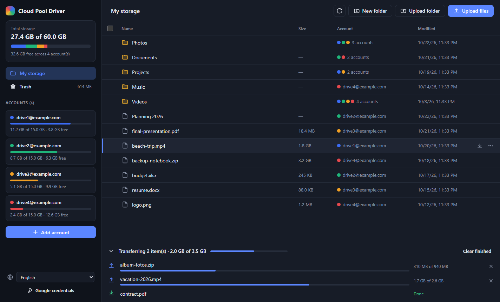

# Cloud Pool Driver

**English** · [Português](README.pt-BR.md)

A Windows desktop app that combines several Google Drive accounts into a single storage space.
With 4 accounts of 15 GB each, you get one 60 GB drive, with upload, download, folders, rename and delete.
You can connect up to **100 accounts** (Google's limit for personal apps that are not verified).
The files that were **already in each account show up too**.

The interface is available in **English and Portuguese**. The language follows your Windows language by
default and can be changed at any time from the selector in the sidebar.



## How it works

- The pool's root is the **My Drive** of every account, merged. A folder is the union of the same folder
  across all accounts: if two accounts have a `Photos` folder, you see a single `Photos` with the files of both.
- Google Docs, Sheets and Slides are downloaded converted to `.docx`, `.xlsx` and `.pptx`.
- Each uploaded file goes **whole** to the account with the most free space at that moment, so it can also
  be opened normally from that account's Google Drive website.
- Uploads are sent in 8 MB chunks (resumable upload). If the connection drops, the app resumes where it
  stopped.
- Access tokens are encrypted with the Windows credential store (DPAPI) in the app's data folder.

## Google Cloud setup (one time, ~5 minutes)

Google requires every app that accesses Drive to have its own credential (an "OAuth client"). You can
create yours for free. **The app itself shows these steps the first time it opens, with a button that takes
you straight to each page.**

1. **Create a project**: open <https://console.cloud.google.com/projectcreate>, type `Cloud Pool Driver` in
   "Project name" and click **Create**. Make sure the new project is selected at the top of the page.
2. **Enable the Google Drive API**: open <https://console.cloud.google.com/apis/library/drive.googleapis.com>
   and click **Enable**.
3. **Set up the sign-in screen**: open <https://console.cloud.google.com/auth/overview> and click
   **Get started**. Fill in the wizard **all the way to the end**:
   - **App information**: name `Cloud Pool Driver` and your email under "User support email". **Next**.
   - **Audience**: **External**. **Next**.
   - **Contact information**: your email. **Next**.
   - **Finish**: tick that you agree to the policy, click **Continue** and then **Create**.

   > **Click Create before opening another page.** If you leave the wizard halfway, Google shows a
   > "complete your Branding changes" warning and won't let you publish. If that already happened, open
   > **Branding** in the left menu, check the app name, the support email and the developer contact email
   > (at the bottom of the page) and click **Save**.
   >
   > Do not upload a logo: with a logo, Google requires app verification.
4. **Publish the app**: open <https://console.cloud.google.com/auth/audience>, click **Publish app** and
   confirm. The status should change to **In production**.
   > In "Testing", Google disconnects your accounts every 7 days. You do not need to submit the app for
   > verification: for personal use it works unverified, with a limit of 100 accounts.
5. **Create the credential**: open <https://console.cloud.google.com/auth/clients>, click **Create client**,
   choose **Desktop app** and click **Create**. In the window that appears, click **Download JSON**.
   > Download it right then: once that window closes, Google never shows the secret again. If you closed it
   > without downloading, create another client.

## Running

```bash
npm install
npm start
```

1. On the first screen, click **Import OAuth client JSON…** and select the downloaded file.
2. Click **Add account**. Your browser opens so you can sign in. Repeat for each account.
   - If you see "Google hasn't verified this app", click **Advanced → Go to (unsafe)**. It is your own app,
     so this is expected.
   - On the permissions screen, keep the Google Drive access checkbox **ticked**.
3. Done: upload files with the buttons or by **dragging files and folders** into the window.

### Building the executable (.exe)

| Command | Output (in `dist/`) |
|---|---|
| `npm run build` | Installer **and** portable version |
| `npm run build:installer` | `CloudPoolDriver-Setup-<version>.exe`: installer with Desktop and Start Menu shortcuts |
| `npm run build:portable` | `CloudPoolDriver-Portable-<version>.exe`: a single .exe that runs without installing |
| `npm run build:dir` | Only the `dist/win-unpacked/` folder (faster, good for testing) |
| `npm run icon` | Regenerates the `build/icon.png` icon |

Data (credentials, accounts and language) is stored in `%APPDATA%\cloud-pool-driver`, so the setup is shared
between the installed and the portable versions.

> The executable is not code-signed. On first launch Windows SmartScreen may show "Windows protected your
> PC". Click **More info → Run anyway**.

### Tests and GitHub Actions

`npm test` runs the core tests against a simulated Google Drive API (no Google account needed).

The workflow [`.github/workflows/build.yml`](.github/workflows/build.yml) runs the tests and builds the
installer and the portable executable. It runs **only on pull requests** and when you start it manually in
**Actions → Build → Run workflow**. The executables are attached to the run as an artifact.

To publish a release, start it manually and tick **Publish a GitHub release**. The release is tagged with the
`version` from `package.json` (e.g. `v1.0.0`), so bump the version before each new release.

### Shortcuts

| Action | What it does |
|---|---|
| Click a folder | Opens it |
| Click a file | Highlights it (Enter, Delete and F2 then act on it) |
| Double-click a file | Downloads it |
| Checkbox, or Ctrl/Shift + click | Selects several items and shows the actions bar |
| Hover a row | Shows the **Download** and **⋯** (more actions) buttons |
| Right-click | Actions menu |
| Delete / F2 | Delete / rename |
| Backspace | Go to the parent folder |
| Ctrl+A / Esc | Select all / clear the selection |

## Limitations

- **A file must fit entirely in one account.** With 4 accounts of 15 GB, a 20 GB file does not fit, even if
  the total free space is larger.
- Google's 15 GB quota is **shared with Gmail and Google Photos** in that account. The space shown already
  accounts for that.
- The app has **full access to the Drive** of each connected account (needed to show the files that were
  already there). Only "My Drive" is shown: "Shared with me", shared drives and shortcuts do not appear.
- Deleting sends the items to the **Google Drive trash**, where they can be restored for 30 days. The space
  is only freed after the trash is emptied. The **Trash** section in the sidebar lets you restore, delete forever
  or empty the trash of every account at once (emptying also removes items trashed on the Google Drive website).
- Forms, Sites and other Google file types that cannot be exported are listed but cannot be downloaded.
- Accounts connected before this version need to be **reconnected** once (the app shows a Reconnect button).
- If you disconnect an account, its files stay in its Drive but disappear from Cloud Pool Driver until you
  connect it again.
- Moving files between folders is not supported yet.

## Troubleshooting

- **`npm start` opens nothing / "Electron failed to install"**: run `node node_modules/electron/install.js`.
- **"Access expired or revoked"** on an account: click **Reconnect**. If this happens every week, the app is
  still in "Testing" mode in Google Cloud (see step 4 of the setup).
- **"Complete your Branding changes" warning in Google Cloud**: the step 3 wizard was not finished. See the note in step 3.
- **403 "Google Drive API has not been used"**: the Drive API is not enabled in the project (step 2).

## Code structure

```
src/
  main.js            Electron main process: windows, IPC, upload/download queue
  preload.js         secure bridge between the UI and the main process
  core/auth.js       OAuth sign-in through the browser (loopback + PKCE)
  core/config.js     credentials, accounts (encrypted tokens) and preferences
  core/pool.js       combines the accounts: unified listing, folders, resumable upload, download
  core/transfers.js  transfer queue with limited concurrency
  renderer/i18n.js   translations (English and Portuguese), used by both the UI and the main process
  renderer/          UI (plain HTML/CSS/JS, no framework)
```

To add a language, add a new dictionary to `src/renderer/i18n.js` and its name to `LANGS`.
