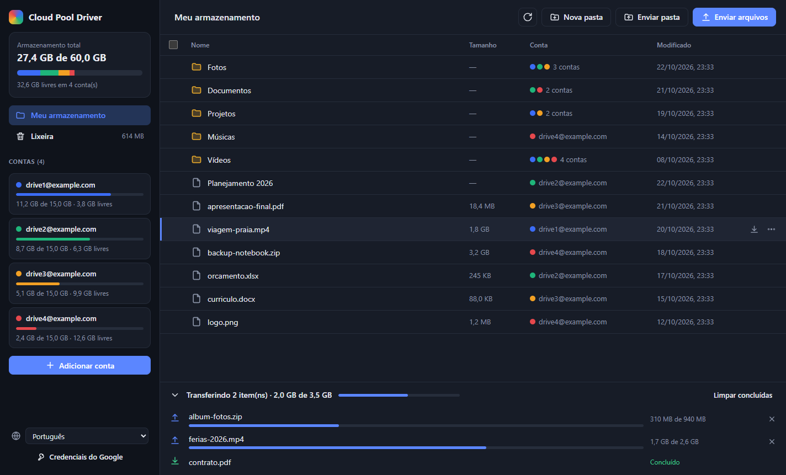

# Cloud Pool Driver

[English](README.md) · **Português**

Programa desktop (Windows) que junta várias contas do Google Drive em um único armazenamento.
Com 4 contas de 15 GB, você vê um disco de 60 GB, com envio, download, pastas, renomear e excluir.
Você pode conectar até **100 contas** (limite do Google para apps pessoais não verificados).
Os arquivos que **já existiam em cada conta também aparecem**.

A interface está disponível em **português e inglês**. O idioma é escolhido automaticamente pelo idioma do
Windows e pode ser trocado a qualquer momento no seletor da barra lateral.



## Como funciona

- A raiz do programa é o **Meu Drive** de todas as contas, juntos. Uma pasta é a junção da mesma pasta em
  todas as contas: se duas contas têm uma pasta `Fotos`, você vê uma única `Fotos` com os arquivos das duas.
- Documentos, Planilhas e Apresentações do Google são baixados convertidos para `.docx`, `.xlsx` e `.pptx`.
- Cada arquivo enviado vai **inteiro** para a conta com mais espaço livre naquele momento. Por isso
  ele também pode ser aberto normalmente pelo site do Google Drive daquela conta.
- O envio é feito em partes de 8 MB (upload *resumable*). Se a conexão cair no meio, o programa
  continua de onde parou.
- Os tokens de acesso ficam criptografados com o cofre do Windows (DPAPI), na pasta de dados do app.

## Configuração do Google Cloud (uma vez só, ~5 minutos)

O Google exige que todo programa que acessa o Drive tenha uma credencial própria (um "cliente OAuth").
Você cria a sua de graça. **O próprio programa mostra esses passos na primeira vez que abre, com um botão
que leva direto para cada página.**

1. **Criar um projeto**: abra <https://console.cloud.google.com/projectcreate>, digite `Cloud Pool Driver`
   em "Nome do projeto" e clique em **Criar**. Confira se o projeto novo ficou selecionado no topo da página.
2. **Ativar a Google Drive API**: abra <https://console.cloud.google.com/apis/library/drive.googleapis.com>
   e clique em **Ativar**.
3. **Configurar a tela de login**: abra <https://console.cloud.google.com/auth/overview> e clique em
   **Começar** (Get started). Preencha o assistente **até o fim**:
   - **Informações do app**: nome `Cloud Pool Driver` e seu e-mail em "E-mail para suporte do usuário". **Próxima**.
   - **Público-alvo**: **Externo**. **Próxima**.
   - **Dados de contato**: seu e-mail. **Próxima**.
   - **Concluir**: marque que concorda com a política, clique em **Continuar** e depois em **Criar**.

   > **Clique em Criar antes de abrir outra página.** Se você sair no meio do assistente, o Google mostra o
   > aviso "conclua as alterações em Branding" e não deixa publicar. Se isso já aconteceu, abra **Branding**
   > no menu da esquerda, confira o nome do app, o e-mail de suporte e o e-mail de contato do desenvolvedor
   > (no fim da página) e clique em **Salvar**.
   >
   > Não envie logotipo: com logotipo, o Google passa a exigir verificação do app.
4. **Publicar o app**: abra <https://console.cloud.google.com/auth/audience>, clique em **Publicar app** e
   confirme. O status deve mudar para **Em produção**.
   > Em "Teste", o Google desconecta as contas a cada 7 dias. Não é preciso enviar o app para verificação: para
   > uso pessoal ele funciona sem verificar, com limite de 100 contas.
5. **Criar a credencial**: abra <https://console.cloud.google.com/auth/clients>, clique em **Criar cliente**,
   escolha **App para computador** e clique em **Criar**. Na janela que aparece, clique em **Baixar JSON**.
   > Baixe nessa hora: depois que a janela fecha, o Google não mostra o segredo de novo. Se fechou sem baixar,
   > crie outro cliente.

## Rodando

```bash
npm install
npm start
```

1. Na primeira tela, clique em **Importar JSON do cliente OAuth…** e selecione o arquivo baixado.
2. Clique em **Adicionar conta**. O navegador abre para você fazer login. Repita para cada conta.
   - Se aparecer a tela "O Google não verificou este app", clique em **Avançado → Acessar (não seguro)**.
     O app é seu, então isso é esperado.
   - Na tela de permissões, deixe **marcada** a caixa de acesso ao Google Drive.
3. Pronto: envie arquivos pelos botões ou **arrastando arquivos e pastas** para a janela.

### Gerar o executável (.exe)

| Comando | O que gera (em `dist/`) |
|---|---|
| `npm run build` | Instalador **e** versão portátil |
| `npm run build:installer` | `CloudPoolDriver-Setup-<versão>.exe`: instalador com atalho na Área de Trabalho e no Menu Iniciar |
| `npm run build:portable` | `CloudPoolDriver-Portable-<versão>.exe`: um único .exe, roda sem instalar |
| `npm run build:dir` | Só a pasta `dist/win-unpacked/` (mais rápido, bom para testar) |
| `npm run icon` | Regera o ícone `build/icon.png` |

Os dados (credenciais, contas e idioma) ficam em `%APPDATA%\cloud-pool-driver`, então a configuração continua
valendo entre a versão instalada e a portátil.

> O executável não é assinado digitalmente. Na primeira execução, o Windows SmartScreen pode avisar
> "O Windows protegeu o computador". Clique em **Mais informações → Executar assim mesmo**.

### Atalhos

| Ação | O que faz |
|---|---|
| Clique em uma pasta | Abre a pasta |
| Clique em um arquivo | Destaca o arquivo (Enter, Delete e F2 passam a agir nele) |
| Duplo clique em um arquivo | Baixa o arquivo |
| Caixa de seleção, ou Ctrl/Shift + clique | Seleciona vários itens e mostra a barra de ações |
| Passar o mouse na linha | Mostra os botões **Baixar** e **⋯** (mais ações) |
| Botão direito | Menu de ações |
| Delete / F2 | Excluir / renomear |
| Backspace | Volta para a pasta anterior |
| Ctrl+A / Esc | Seleciona tudo / limpa a seleção |

## Limitações

- **Um arquivo precisa caber inteiro em uma conta.** Com 4 contas de 15 GB, um arquivo de 20 GB não cabe,
  mesmo que o total livre seja maior.
- A cota de 15 GB do Google é **dividida com o Gmail e o Google Fotos** daquela conta. O espaço mostrado
  já leva isso em conta.
- O programa tem **acesso completo ao Drive** de cada conta conectada (necessário para mostrar os arquivos que
  já existiam). Só o "Meu Drive" aparece: "Compartilhados comigo", drives compartilhados e atalhos não aparecem.
- Excluir manda os itens para a **lixeira do Google Drive**, onde podem ser restaurados por 30 dias. O espaço
  só é liberado depois que a lixeira é esvaziada. A seção **Lixeira** na barra lateral permite restaurar, excluir
  para sempre ou esvaziar a lixeira de todas as contas de uma vez (esvaziar também apaga itens excluídos pelo site
  do Google Drive).
- Formulários, Sites e outros tipos de arquivo do Google que não podem ser exportados aparecem na lista, mas
  não podem ser baixados.
- Contas conectadas antes desta versão precisam ser **reconectadas** uma vez (o app mostra o botão Reconectar).
- Se você desconectar uma conta, os arquivos dela continuam no Drive, mas somem do Cloud Pool Driver até você
  conectá-la de novo.
- Mover arquivos entre pastas ainda não é suportado.

## Problemas comuns

- **`npm start` não abre nada / erro "Electron failed to install"**: rode `node node_modules/electron/install.js`.
- **"Acesso expirado ou revogado"** em uma conta: clique em **Reconectar**. Se isso acontecer toda semana,
  o app está em modo "Teste" no Google Cloud (veja o passo 4 da configuração).
- **Aviso "conclua as alterações em Branding" no Google Cloud**: o assistente do passo 3 não foi concluído. Veja a nota do passo 3.
- **Erro 403 "Google Drive API has not been used"**: a Drive API não foi ativada no projeto (passo 2).

## Estrutura do código

```
src/
  main.js            processo principal do Electron: janelas, IPC, fila de envio e download
  preload.js         ponte segura entre a interface e o processo principal
  core/auth.js       login OAuth pelo navegador (loopback + PKCE)
  core/config.js     credenciais, contas (tokens criptografados) e preferências
  core/pool.js       junta as contas: listagem unificada, pastas, upload resumable, download
  core/transfers.js  fila de transferências com concorrência limitada
  renderer/i18n.js   traduções (português e inglês), usadas pela interface e pelo processo principal
  renderer/          interface (HTML/CSS/JS puro, sem framework)
```

Para adicionar um idioma, inclua um novo dicionário em `src/renderer/i18n.js` e o nome dele em `LANGS`.
